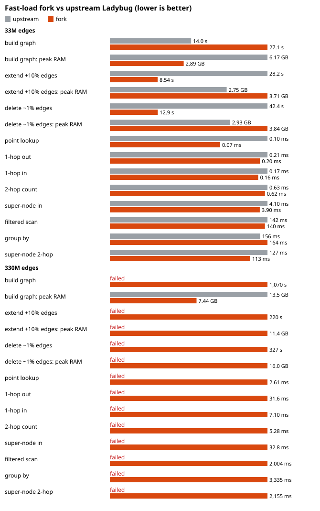

<div align="center">
  <picture>
    <!-- <source srcset="https://ladybugdb.com/img/lbug-logo-dark.png" media="(prefers-color-scheme: dark)"> -->
    
  </picture>
</div>

<br>

<p align="center">
  <a href="https://github.com/LadybugDB/ladybug/actions">
    </a>
  <a href="https://deepwiki.com/LadybugDB/ladybug"></a>
  <a href="https://discord.com/invite/hXyHmvW3Vy">
    </a>
  <a href="https://twitter.com/lbugdb">
    </a>
</p>

# Ladybug, fast-load fork

A fork of [Ladybug](https://github.com/LadybugDB/ladybug) (formerly [Kuzu](https://github.com/kuzudb/kuzu)) optimized for
**building, extending and editing very large graphs inside one process with bounded memory**: hundreds of millions to
billions of relationships on a single machine, without running a server. Query behaviour and the Cypher dialect are
unchanged; everything upstream offers still works.



At 330M relationships with an 8 GB buffer pool, upstream Ladybug cannot build the graph ("buffer pool is full", 13.5 GB
RSS); this fork builds, extends and edits it. At 33M relationships, both build; the fork uses half the memory to build
and extends and deletes about 3x faster. Query speed is unchanged: the query engine is upstream's.

<details><summary>All numbers</summary>

| Data | Measure | Upstream | Fork | Speed-up |
|---|---|---|---|---|
| 33M edges | build graph | 14.0 s | 27.1 s | 0.5x |
| 33M edges | build graph: peak RAM | 6.17 GB | 2.89 GB | 2.1x |
| 33M edges | extend +10% edges | 28.2 s | 8.54 s | 3.3x |
| 33M edges | extend +10% edges: peak RAM | 2.75 GB | 3.71 GB | 0.7x |
| 33M edges | delete ~1% edges | 42.4 s | 12.9 s | 3.3x |
| 33M edges | delete ~1% edges: peak RAM | 2.93 GB | 3.84 GB | 0.8x |
| 33M edges | point lookup | 0.10 ms | 0.07 ms | 1.4x |
| 33M edges | 1-hop out | 0.21 ms | 0.20 ms | 1.0x |
| 33M edges | 1-hop in | 0.17 ms | 0.16 ms | 1.1x |
| 33M edges | 2-hop count | 0.63 ms | 0.62 ms | 1.0x |
| 33M edges | super-node in | 4.10 ms | 3.90 ms | 1.1x |
| 33M edges | filtered scan | 142 ms | 140 ms | 1.0x |
| 33M edges | group by | 156 ms | 164 ms | 1.0x |
| 33M edges | super-node 2-hop | 127 ms | 113 ms | 1.1x |
| 330M edges | build graph | failed | 1,070 s | upstream fails |
| 330M edges | build graph: peak RAM | 13.5 GB | 7.44 GB | 1.8x |
| 330M edges | extend +10% edges | failed | 220 s | upstream fails |
| 330M edges | extend +10% edges: peak RAM | failed | 11.4 GB | upstream fails |
| 330M edges | delete ~1% edges | failed | 327 s | upstream fails |
| 330M edges | delete ~1% edges: peak RAM | failed | 16.0 GB | upstream fails |
| 330M edges | point lookup | failed | 2.61 ms | upstream fails |
| 330M edges | 1-hop out | failed | 31.6 ms | upstream fails |
| 330M edges | 1-hop in | failed | 7.10 ms | upstream fails |
| 330M edges | 2-hop count | failed | 5.28 ms | upstream fails |
| 330M edges | super-node in | failed | 32.8 ms | upstream fails |
| 330M edges | filtered scan | failed | 2,004 ms | upstream fails |
| 330M edges | group by | failed | 3,335 ms | upstream fails |
| 330M edges | super-node 2-hop | failed | 2,155 ms | upstream fails |

</details>

Synthetic transaction graph (`scripts/benchmark/gen.py`: 30% of transfers to skewed super-nodes), 8 GB buffer pool,
16 vCPU / 24 GB RAM, upstream = the `ladybug` 0.22.0 wheel from PyPI. Reproduce with `scripts/benchmark/run.sh`;
raw results in `scripts/benchmark/results.jsonl`. The fork's peak RAM includes the bucketed loader's DuckDB (capped
at 3 GB) running in the same process.

Also in this fork: full-text search and graph algorithms work offline (linked in; upstream needs `INSTALL` from the
network and `LOAD algo` fails on Linux), and `import kuzu` and `import ladybug` work in one process.

## What changed

- **Bucketed relationship COPY.** `DIRECTION='fwd'|'bwd'` builds one direction's CSR; `RAW_OFFSETS=true` takes source,
  destination and relationship offsets from the input; `REL_OFFSETS=true` keeps the key lookups but takes the
  relationship offset from the input; `NODE_GROUP_BEGIN/END` keeps only one range of node groups. A COPY leaves the
  node groups it does not touch alone. A loader copies one node-group-aligned bucket at a time, so memory is bounded by
  the bucket, not the table: [`scripts/bucketed_load`](scripts/bucketed_load) (with DuckDB, or with the engine only).
- **Faster extend.** A COPY into populated node groups is merged at checkpoint in contiguous runs, and the node groups
  of a relationship table are checkpointed in parallel, each rolled back on its own if it fails.
- **Faster bulk delete.** DELETE and DETACH DELETE find the rows of a whole batch of relationships with one scan per
  adjacency list, and the checkpoint copies the live runs of a list around its deletions.
- **Shadow file fix.** The map from data pages to shadow pages is no longer read without its lock: concurrent
  checkpoint writers could lose updates.
- **Bundled extensions.** `make python-bundled` links `fts` and `algo` (PAGE_RANK, WCC, SCC, LOUVAIN, K_CORE) into the
  Python module.
- **Coexists with Kuzu.** Module-local bindings, `-Bsymbolic`, and a local load of the native module.

## Build

```bash
git clone --recurse-submodules https://github.com/Seragonia/ladybug
cd ladybug && make python-bundled
export PYTHONPATH=$PWD/tools/python_api/build
```

Experimental: correctness is checked by the tests in [`scripts/bucketed_load`](scripts/bucketed_load) (bucketed loads,
extends, deletes and updates compared against a stock COPY and against DuckDB, WAL replay, rollback, reopen), run
repeatedly, not by a full run of upstream's suite.

---

## Upstream README

## Ladybug
Ladybug is an embedded graph database built for query speed and scalability. Ladybug is optimized for handling complex analytical workloads
on very large databases and provides a set of retrieval features, such as a full text search and vector indices. Our core feature set includes:

- Flexible Property Graph Data Model and Cypher query language
- Embeddable, serverless integration into applications
- Native full text search and vector index
- Columnar disk-based storage
- Columnar sparse row-based (CSR) adjacency list/join indices
- Vectorized and factorized query processor
- Novel and very fast join algorithms
- Multi-core query parallelism
- Serializable ACID transactions
- Wasm (WebAssembly) bindings for fast, secure execution in the browser

Ladybug is being developed by [LadybugDB Developers](https://github.com/LadybugDB) and
is available under a permissive license. So try it out and help us make it better! We welcome your feedback and feature requests.

The database was formerly known as [Kuzu](https://github.com/kuzudb/kuzu).

## Installation

| Language | Installation                                                           |
| -------- |------------------------------------------------------------------------|
| Python   | `pip install ladybug`                                             |
| NodeJS   | `npm install @ladybugdb/core`                                            |
| Rust     | `cargo add lbug`                                                       |
| Go       | `go get github.com/LadybugDB/go-ladybug`                                     |
| Swift    | [lbug-swift](https://github.com/LadybugDB/swift-ladybug)                     |
| Java     | [Maven Central](https://central.sonatype.com/artifact/com.ladybugdb/lbug) |
| C/C++    | [precompiled binaries](https://github.com/LadybugDB/ladybug/releases/latest) |
| CLI      | [precompiled binaries](https://github.com/LadybugDB/ladybug/releases/latest) |

To learn more about installation, see our [Installation](https://docs.ladybugdb.com/installation) page.

## Getting Started

Refer to our [Getting Started](https://docs.ladybugdb.com/get-started/) page for your first example.

## Build from Source

You can build from source using the instructions provided in the [developer guide](https://docs.ladybugdb.com/developer-guide/).

## Contributing
We welcome contributions to Ladybug. If you are interested in contributing to Ladybug, please read our [Contributing Guide](CONTRIBUTING.md).

## License
By contributing to Ladybug, you agree that your contributions will be licensed under the [MIT License](LICENSE).

## Contact
You can contact us at [social@ladybugdb.com](mailto:social@ladybugdb.com) or [join our Discord community](https://discord.com/invite/hXyHmvW3Vy).
